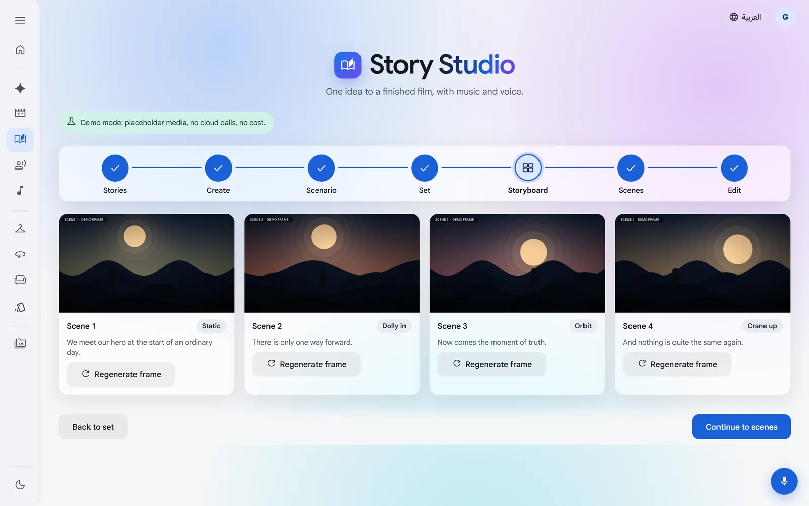
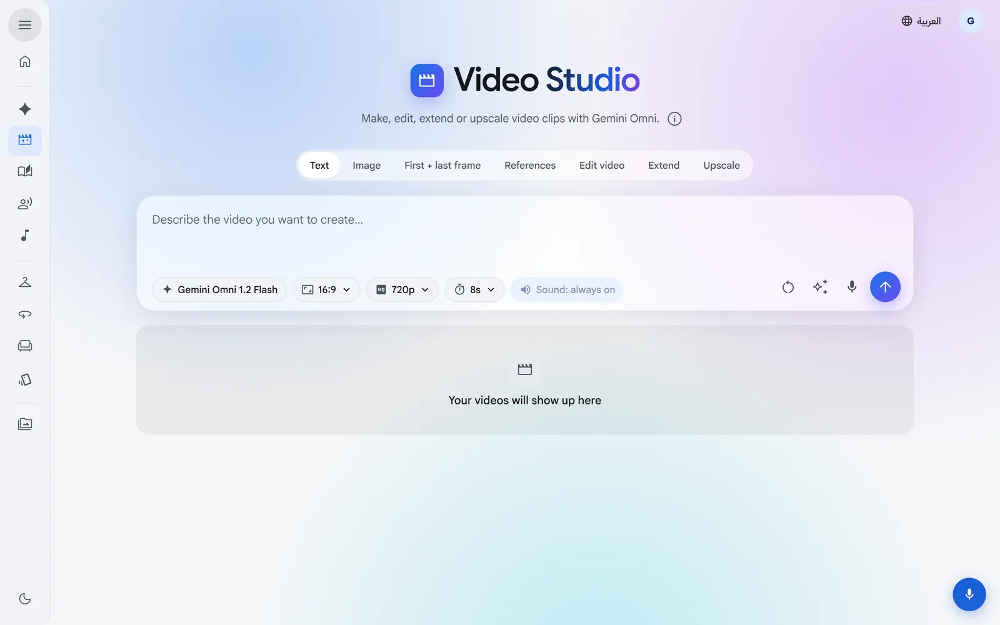
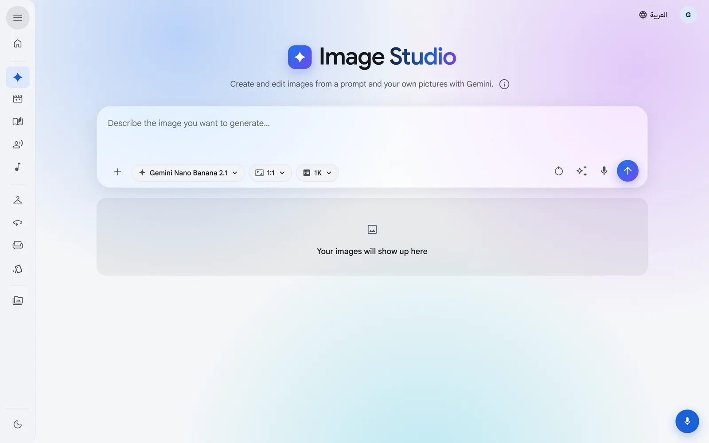
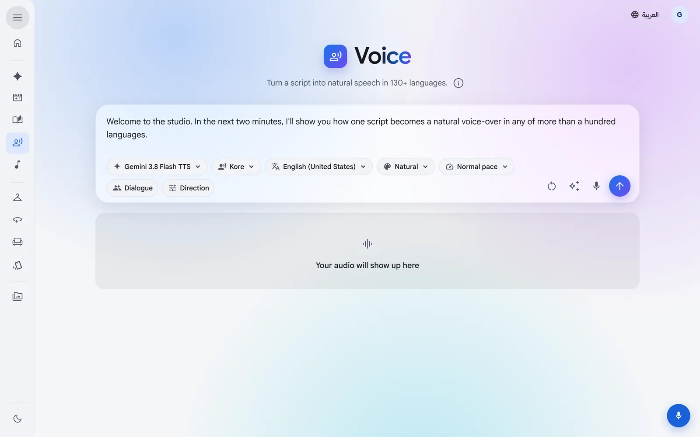
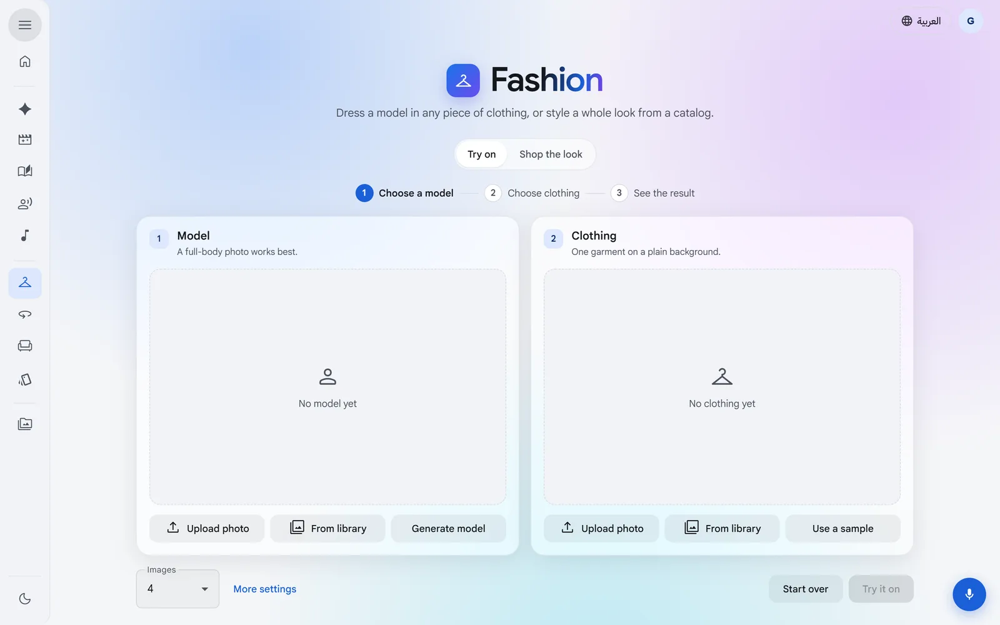
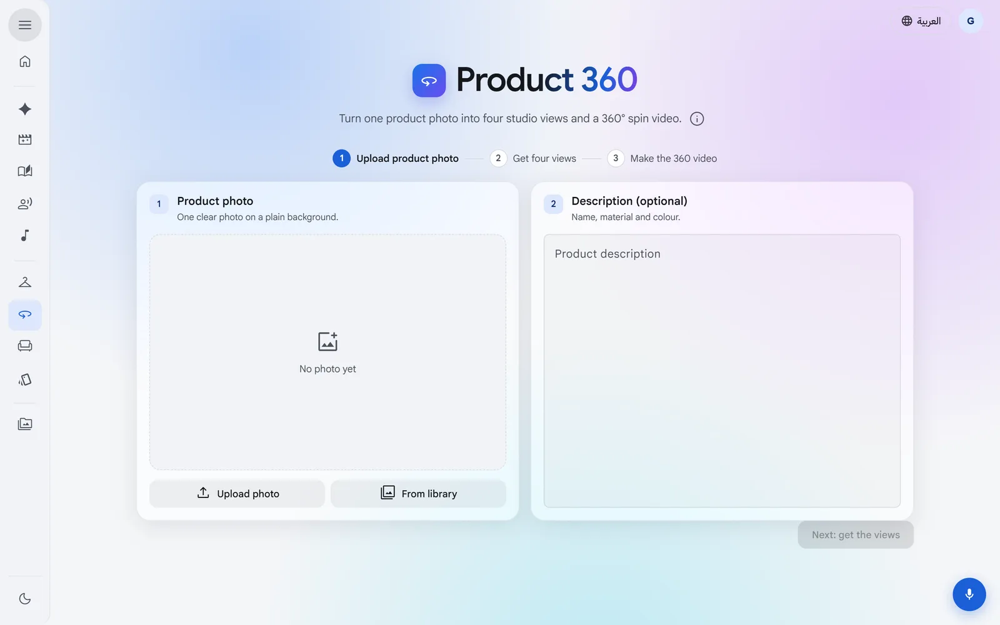
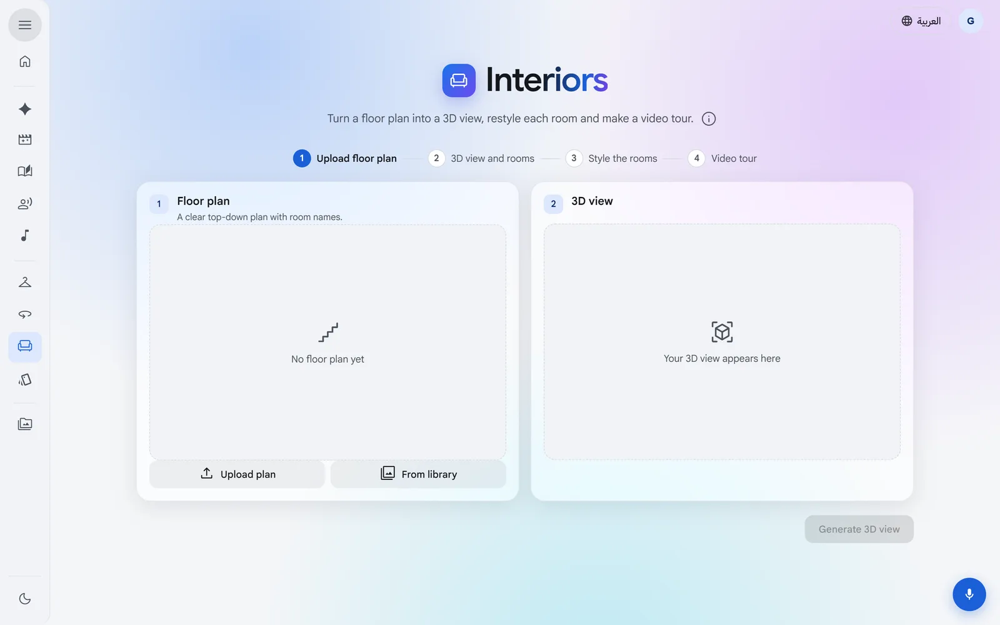
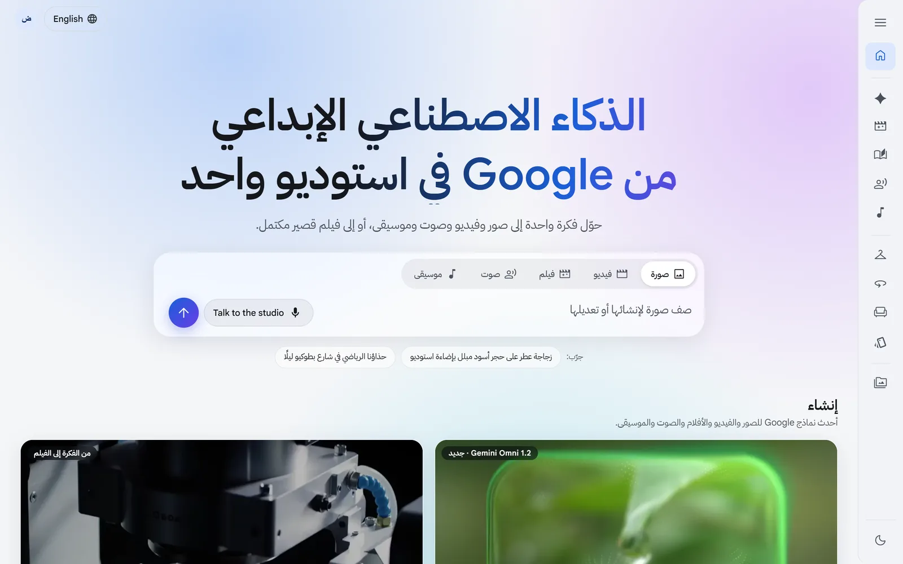
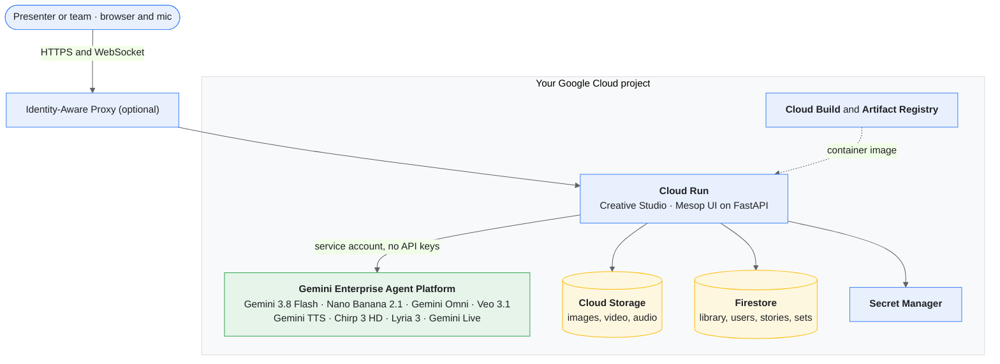

<div align="center">

# Creative Studio

### Google's creative AI, in one studio.

One idea becomes an image, a video, a voice-over, a song, or a finished short film,<br>
using Google's newest generative models on **Gemini Enterprise Agent Platform** (formerly Vertex AI), deployed to **Cloud Run** with one command.

[](LICENSE)
[](pyproject.toml)
[](#the-google-models-inside)
[](deploy/quickstart/README.md)
[](#built-for-real-demos)

[Studios](#the-studios) · [Models](#the-google-models-inside) · [Try it free](#try-it-in-two-minutes) · [Deploy](#deploy-to-your-google-cloud-project) · [Architecture](#architecture) · [Demo script](#a-five-minute-demo)

<br>

<picture>
  <source media="(prefers-color-scheme: dark)" srcset="docs/images/home-dark.webp">
  <source media="(prefers-color-scheme: light)" srcset="docs/images/home-light.webp">
  
</picture>

</div>

## Why it exists

Google's media models are best understood by watching them work together. Creative Studio puts them in one polished app a presenter can open in front of a customer: type an idea once, pick what to make, and the right studio opens with the idea filled in. Or click **Talk to the studio** and drive the whole app by voice.

- **Every modality in one place.** Images, video, speech, music and multi-scene films share one prompt box, one library and one look.
- **Real workflows, not just prompts.** Film Studio chains five models into a finished film; the industry demos show retail, real estate and brand use cases end to end.
- **Yours in your own project.** One script deploys it to Cloud Run in your Google Cloud project. It uses Google Cloud credentials (no API keys), keeps every file in your own bucket, and costs nothing while idle.

### What this adds to Google's GenMedia Creative Studio

Creative Studio builds on Google's open-source [GenMedia Creative Studio](https://github.com/GoogleCloudPlatform/genmedia-creative-studio) and keeps its features, so upstream fixes still merge in. On top of it:

| Added here | What it means for a demo |
|---|---|
| **One prompt for everything** | The home page routes one idea to the right studio, already filled in. |
| **Film Studio, idea to film** | Script, set, storyboard, scenes with on-camera speech, narration, music, a timeline editor and an Arabic version. |
| **Talk to the studio** | A Gemini Live agent drives the app by voice and runs several jobs at once. |
| **English and Arabic** | Every screen, right to left, in light and dark. |
| **A redesigned interface** | One look across every studio, fewer clicks, works on a phone. |
| **One-command deploy and demo mode** | Live in your own project in minutes, or rehearse with no cloud account at all. |

## The studios

<table>
  <tr>
    <td width="50%" valign="top">
      <picture>
        <source media="(prefers-color-scheme: dark)" srcset="docs/images/story-dark.webp">
        
      </picture>
      <h3>Film Studio</h3>
      One idea to a finished film. Gemini writes the script, Nano Banana paints the storyboard, Gemini Omni shoots each scene with sound and on-camera speech, Gemini TTS narrates and Lyria scores it. Finish it in the timeline editor, export an Arabic version, and reuse <b>Sets</b> (the same characters, places and voices) across films.
    </td>
    <td width="50%" valign="top">
      <picture>
        <source media="(prefers-color-scheme: dark)" srcset="docs/images/video-dark.webp">
        
      </picture>
      <h3>Video Studio</h3>
      Make video from text, a picture, first and last frames or reference images, then edit, extend or upscale it. Gemini Omni makes the picture and the sound together; Veo 3.1 is available as an option.
    </td>
  </tr>
  <tr>
    <td width="50%" valign="top">
      <picture>
        <source media="(prefers-color-scheme: dark)" srcset="docs/images/image-dark.webp">
        
      </picture>
      <h3>Image Studio</h3>
      Create and edit images from a prompt and your own reference pictures with Nano Banana 2.1. Settings typed in the prompt ("16:9", "4K") update the chips, and one click turns any image into a video.
    </td>
    <td width="50%" valign="top">
      <picture>
        <source media="(prefers-color-scheme: dark)" srcset="docs/images/voice-dark.webp">
        
      </picture>
      <h3>Voice and Music</h3>
      Natural speech in 130+ languages with one or two speakers and stage directions (Gemini TTS, Chirp 3 HD). Original music, with or without lyrics, from Lyria 3.
    </td>
  </tr>
</table>

### Talk to the studio

A **Gemini Live** voice agent runs the app for you. Say *"make an image of a red fox in the snow, and while that's going, start a video of waves at sunset"*: the agent opens each studio, types the prompt, runs the jobs side by side, and tells you at the next pause when each one is ready. You can hang up and type instead at any time.

### Industry demos

<table>
  <tr>
    <td width="33%" valign="top">
      <picture>
        <source media="(prefers-color-scheme: dark)" srcset="docs/images/fashion-dark.webp">
        
      </picture>
      <b>Fashion</b><br>Dress a model in any garment, or style a whole look from a catalog.
    </td>
    <td width="33%" valign="top">
      <picture>
        <source media="(prefers-color-scheme: dark)" srcset="docs/images/product-dark.webp">
        
      </picture>
      <b>Product 360</b><br>One product photo becomes a 360° turntable video.
    </td>
    <td width="33%" valign="top">
      <picture>
        <source media="(prefers-color-scheme: dark)" srcset="docs/images/interiors-dark.webp">
        
      </picture>
      <b>Interiors</b><br>A floor plan becomes a 3D view, restyled rooms and a video tour.
    </td>
  </tr>
</table>

Plus **Brand kit**, a set of on-brand campaign images from one idea, and the **Library**, where everything anyone makes is saved with its prompt and settings.

## The Google models inside

| Model | What it does here | Used in |
|---|---|---|
| **Gemini 3.8 Flash** | Scripts, scene plans, prompt rewriting, the "suggest" and "enhance" buttons | Every studio |
| **Nano Banana 2.1** (Gemini image) | Image creation and editing, storyboards, try-on, rooms, brand sets | Image, Story, Fashion, Interiors, Brand kit |
| **Gemini Omni 1.2 Flash** | Video with native sound and speech, edits, extensions | Video, Story, Product 360, Interiors |
| **Veo 3.1** (optional) | Alternative video model | Video |
| **Gemini TTS** and **Chirp 3 HD** | Narration and voice-over in 130+ languages | Voice, Story |
| **Lyria 3** | Instrumental music and songs with lyrics | Music, Story |
| **Gemini Live** | Real-time voice agent that drives the app | Talk to the studio |

Every model ID is a setting, so a new model version is a config change: see [docs/environment_variables.md](docs/environment_variables.md).

## Built for real demos

<picture>
  <source media="(prefers-color-scheme: dark)" srcset="docs/images/arabic-dark.webp">
  
</picture>

- **English and Arabic.** Every screen switches language and direction (right to left) with one click, in light or dark.
- **Demo mode.** Run with no Google Cloud account: every studio returns placeholder media instantly, so you can rehearse or click through the whole app for free.
- **Sign-in your way.** Built-in admin and user roles, or Google sign-in through Identity-Aware Proxy. Admins choose whether the Library is shared or private to each person.
- **Phone-ready.** Every page works from 390 px wide up.

## Try it in two minutes

You need [`uv`](https://docs.astral.sh/uv/). Demo mode needs no cloud account and costs nothing.

```bash
git clone https://github.com/ProjectZero02/creative-studio.git
cd creative-studio
uv sync
APP_ENV=local GENMEDIA_MOCK_GENERATION=true STORY_STUDIO_MOCK=true uv run src/main.py
```

Open <http://localhost:8080>. Add `?live=offline` to any page to try the voice agent by typing.

To use the real models, run `gcloud auth application-default login`, copy `dotenv.template` to `.env`, set `PROJECT_ID` and `GENMEDIA_BUCKET`, and run `uv run src/main.py`.

## Deploy to your Google Cloud project

One script turns on the APIs and creates the service account, bucket, Firestore database and secrets, then builds and deploys to Cloud Run. It is safe to re-run, and an idle studio scales to zero.

```bash
bash deploy/quickstart/deploy.sh --project YOUR_PROJECT --admin-email you@company.com
```

Add `--dry-run` to see every command first, or `--region` to pick another region (default `us-central1`). Prefer infrastructure as code? Terraform modules are in [`deploy/terraform`](deploy/terraform). Full guide: [`deploy/quickstart/README.md`](deploy/quickstart/README.md).

## Architecture



- **One Cloud Run service** serves the UI and API, with session affinity for the Gemini Live WebSocket. It scales to zero when nobody is using it.
- **Gemini Enterprise Agent Platform** is called with the service account's credentials, so there are no API keys to leak or rotate.
- **Cloud Storage** holds every generated file; **Firestore** holds the library, users, stories and sets.
- Long jobs (films, multi-scene renders) run in the background and survive page changes.

| Folder | What's in it |
|---|---|
| `src/` | The app: `main.py`, `pages/` (one file per studio), `components/`, `models/` (model calls), `services/` (story, live agent and job runners), `routers/`, `state/`, `config/` |
| `deploy/` | Cloud Run quickstart, Cloud Build files and Terraform |
| `test/` | `pytest` suite (700+ tests) |
| `docs/` | Configuration reference, FAQ, plans and screenshots |
| `experiments/` | Stand-alone apps and MCP servers from upstream |

## A five-minute demo

1. **Home.** Type *"Our sneaker on a Tokyo street at night"*, pick **Image**, and press send. Image Studio opens with the prompt filled in.
2. **Image to video.** Click **Make a video** on the result. Gemini Omni animates it, with sound.
3. **Film.** In Film Studio, type one line, for example *"A coffee brand's 30-second ad: sunrise, first sip, city waking up"*. Walk through script, set, storyboard and scenes, then play the finished film in the editor.
4. **Arabic.** Click **العربية**. The whole app flips to Arabic, right to left. Turn on the Arabic version of the film.
5. **Voice.** Click **Talk to the studio** and ask for two things at once. The app works by itself while you talk.

## Contributing

Issues and pull requests are welcome; see [CONTRIBUTING.md](CONTRIBUTING.md). Run `uv run pytest -q` before you open a PR.

## License

A fork of Google's open-source [GenMedia Creative Studio](https://github.com/GoogleCloudPlatform/genmedia-creative-studio), licensed under [Apache 2.0](LICENSE). This is not an officially supported Google product. It is built for demos and workshops, not production workloads.
