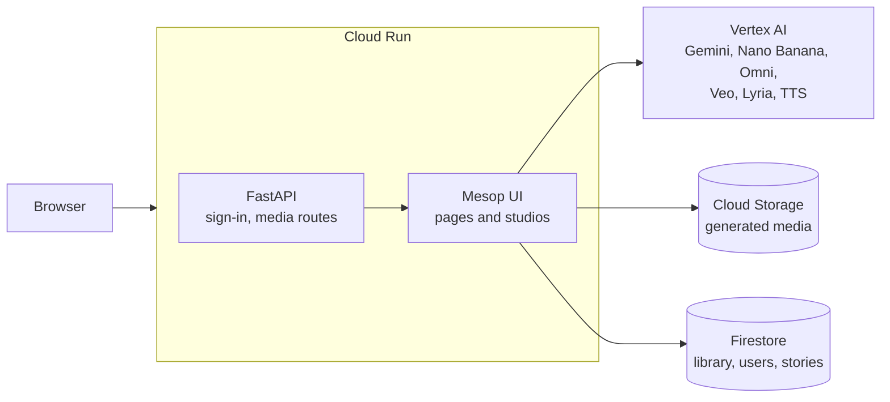

<div align="center">

# GenMedia Studio

**Google's creative AI in one studio: images, video, films, voice and music, on Vertex AI and Cloud Run.**

Built for client demos. Type one idea on the home page, pick Image, Video, Film, Voice or Music, and the right studio opens.

[](LICENSE)
[](pyproject.toml)
[](https://mesop-dev.github.io/mesop/)
[](deploy/quickstart/README.md)
[](https://cloud.google.com/vertex-ai)

[Quick start](#quick-start) · [Deploy to Cloud Run](deploy/quickstart/README.md) · [Features](#features) · [Configuration](environment_variables.md) · [Contributing](#contributing)

<br>

<picture>
  <source media="(prefers-color-scheme: dark)" srcset="docs/images/home-dark.webp">
  <source media="(prefers-color-scheme: light)" srcset="docs/images/home-light.webp">
  
</picture>

</div>

> [!NOTE]
> This is not an officially supported Google product. It is meant for demos, not production. It is not eligible for the [Google Open Source Software Vulnerability Rewards Program](https://bughunters.google.com/open-source-security).

## Contents

- [Features](#features)
- [Quick start](#quick-start)
- [Deploy to Cloud Run](#deploy-to-cloud-run)
- [How it works](#how-it-works)
- [Configuration](#configuration)
- [Contributing](#contributing)
- [Credits and license](#credits-and-license)

## Features

### Create

| | Studio | What it does | Models |
|---|---|---|---|
| 🖼️ | **Image Studio** | Make and edit images from a prompt and reference pictures. | Nano Banana 2.1 |
| 🎬 | **Video Studio** | Make, edit, extend or upscale video from a prompt, a picture, first and last frames, or references. | Gemini Omni 1.2 (default), Veo 3.1 |
| 📖 | **Story Studio** | One idea to a finished film: script, storyboard, scenes, voice-over and music. | Gemini, Nano Banana, Veo 3.1, Gemini TTS, Lyria |
| 🎙️ | **Voice** | Turn a script into natural speech in 130+ languages, with one or two speakers. | Gemini 3.8 Flash TTS, Chirp 3 HD |
| 🎵 | **Music** | Original music, with or without lyrics. | Lyria 3 |

### Industry demos

| | Demo | What it does |
|---|---|---|
| 👗 | **Fashion** | Dress a model in any outfit, or build a shop-the-look set. |
| 🔄 | **Product 360** | Turn one product photo into a 360° turntable video. |
| 🛋️ | **Interiors** | A floor plan to furnished rooms and a walkthrough video. |
| 🎨 | **Brand kit** | A set of on-brand images from one campaign idea. |

### Studio

- **Library.** Every image, video and audio clip you make, in one place, with the prompt and settings that made it.
- **Sign-in with roles.** The studio's own sign-in page with **admin** and **user** roles. Admins add people, change roles, disable accounts and reset passwords at `/admin/users`. Google sign-in through Identity-Aware Proxy also works.

<table>
  <tr>
    <td width="50%">
      <picture>
        <source media="(prefers-color-scheme: dark)" srcset="docs/images/story-dark.webp">
        
      </picture>
      <p align="center"><b>Story Studio</b></p>
    </td>
    <td width="50%">
      <picture>
        <source media="(prefers-color-scheme: dark)" srcset="docs/images/video-dark.webp">
        
      </picture>
      <p align="center"><b>Video Studio</b></p>
    </td>
  </tr>
</table>

## Quick start

You need [`uv`](https://docs.astral.sh/uv/) (it installs Python 3.14 for you). Chrome gives the best experience.

### Try it without Google Cloud (mock mode)

Mock mode returns placeholder images, a sample clip and a short chime instead of calling Vertex AI, so you can click through every page for free. It only works when `APP_ENV` is `local` or `dev`.

```bash
git clone https://github.com/ProjectZero02/genmedia-studio.git
cd genmedia-studio
uv sync
APP_ENV=local GENMEDIA_MOCK_GENERATION=true STORY_STUDIO_MOCK=true uv run main.py
```

Open <http://localhost:8080>. Set `PORT` to use another port.

### Run it with real models

```bash
gcloud auth application-default login
cp dotenv.template .env        # then set PROJECT_ID and GENMEDIA_BUCKET
uv sync
uv run main.py
```

Your Google Cloud project needs Vertex AI, Firestore and a Cloud Storage bucket. The [quickstart script](deploy/quickstart/README.md) can create them for you.

## Deploy to Cloud Run

One script sets up the project (APIs, service account, bucket, Firestore, secrets) and deploys the studio. It is safe to re-run.

```bash
bash deploy/quickstart/deploy.sh --project YOUR_PROJECT --admin-email you@company.com
```

Add `--dry-run` to see every command first. Choose `--auth session` (the studio's own sign-in, the default) or `--auth iap` (Google sign-in). An idle studio scales to zero. Full guide: [`deploy/quickstart/README.md`](deploy/quickstart/README.md).

Prefer Terraform, a custom domain and a load balancer? Use the upstream [deployment guide](https://googlecloudplatform.github.io/genmedia-creative-studio/core/installation/deploy/).

## How it works



- **UI:** [Mesop](https://mesop-dev.github.io/mesop/), a Python UI framework, mounted on **FastAPI**. Pages live in `pages/`, shared parts in `components/`.
- **Models:** every call goes through **Vertex AI** with Google Cloud credentials (no API keys in code). Model code lives in `models/`.
- **Storage:** generated files go to **Cloud Storage**. The library, users and Story Studio projects live in **Firestore**.
- **Hosting:** one **Cloud Run** service, built from the `Dockerfile`.

## Configuration

Every setting is an environment variable with a sensible default. [`dotenv.template`](dotenv.template) lists the common ones, and [`environment_variables.md`](environment_variables.md) explains them all, including how to change the default model for each studio.

## Contributing

Issues and pull requests are welcome. Please read [CONTRIBUTING.md](CONTRIBUTING.md) first. Before you open a PR:

```bash
uv run pytest -q
uv run ruff check <files you changed>
```

## Credits and license

GenMedia Studio is a fork of Google's [GenMedia Creative Studio](https://github.com/GoogleCloudPlatform/genmedia-creative-studio), with a new look, sign-in, Story Studio, new Voice, Fashion and Video Studio pages, and a one-command Cloud Run deploy. Upstream changes are merged in regularly. The stand-alone apps and MCP servers in [`experiments/`](experiments/) come from upstream; see its [experiments guide](https://googlecloudplatform.github.io/genmedia-creative-studio/experiments/overview/).

Licensed under the [Apache License 2.0](LICENSE).

> [!CAUTION]
> This is **not** an officially supported Google product. This project is not eligible for the [Google Open Source Software Vulnerability Rewards Program](https://bughunters.google.com/open-source-security).
