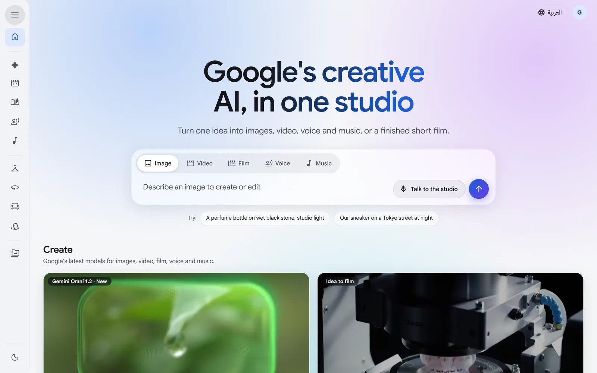
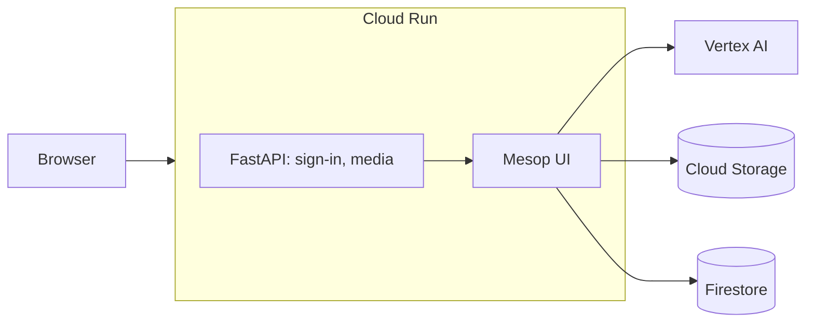

<div align="center">

# GenMedia Studio

**Google's creative AI in one studio: images, video, films, voice and music, on Vertex AI and Cloud Run.**

[](LICENSE)
[](pyproject.toml)
[](deploy/quickstart/README.md)

[Quick start](#quick-start) · [Deploy](#deploy-to-cloud-run) · [Configuration](environment_variables.md) · [Contributing](CONTRIBUTING.md)

<br>

<picture>
  <source media="(prefers-color-scheme: dark)" srcset="docs/images/home-dark.webp">
  <source media="(prefers-color-scheme: light)" srcset="docs/images/home-light.webp">
  
</picture>

</div>

Type one idea on the home page, pick Image, Video, Film, Voice or Music, and the right studio opens with your idea filled in. The whole studio works in English and Arabic (right to left), in light and dark.

## Features

| Studio | What it does | Models |
|---|---|---|
| **Image** | Make and edit images from a prompt and reference pictures. | Nano Banana 2.1 |
| **Video** | Make, edit, extend or upscale video from a prompt, a picture or frames. | Gemini Omni 1.2, Veo 3.1 |
| **Story** | One idea to a finished film: script, storyboard, scenes, voice-over and music. | Gemini, Nano Banana, Veo, Lyria |
| **Voice** | A script to natural speech in 130+ languages, one or two speakers. | Gemini 3.8 Flash TTS, Chirp 3 HD |
| **Music** | Original music, with or without lyrics. | Lyria 3 |

Industry demos: **Fashion** try-on, **Product 360** turntables, **Interiors** from a floor plan, and **Brand kit** campaigns. Everything you make lands in the **Library**, and sign-in comes with **admin** and **user** roles (or Google sign-in through IAP).

<table>
  <tr>
    <td width="50%">
      <picture>
        <source media="(prefers-color-scheme: dark)" srcset="docs/images/story-dark.webp">
        
      </picture>
    </td>
    <td width="50%">
      <picture>
        <source media="(prefers-color-scheme: dark)" srcset="docs/images/video-dark.webp">
        
      </picture>
    </td>
  </tr>
</table>

## Quick start

You need [`uv`](https://docs.astral.sh/uv/). Mock mode needs no Google Cloud account: it returns placeholder media so you can click through every page for free.

```bash
git clone https://github.com/ProjectZero02/genmedia-studio.git
cd genmedia-studio
uv sync
APP_ENV=local GENMEDIA_MOCK_GENERATION=true STORY_STUDIO_MOCK=true uv run main.py
```

Open <http://localhost:8080>. For real models, run `gcloud auth application-default login`, copy `dotenv.template` to `.env`, set `PROJECT_ID` and `GENMEDIA_BUCKET`, then `uv run main.py`.

## Deploy to Cloud Run

One script sets up the project (APIs, service account, bucket, Firestore, secrets) and deploys. It is safe to re-run, and an idle studio scales to zero.

```bash
bash deploy/quickstart/deploy.sh --project YOUR_PROJECT --admin-email you@company.com
```

Add `--dry-run` to preview every command. Full guide: [`deploy/quickstart/README.md`](deploy/quickstart/README.md).

## How it works



| Folder | What's in it |
|---|---|
| `pages/` | One file per studio page |
| `components/` | Shared UI parts and web components |
| `models/` | Vertex AI calls for each model |
| `services/`, `routers/` | Background jobs, sign-in and media routes |
| `state/`, `config/`, `common/` | Page state, settings, shared helpers |
| `assets/ui/` | Theme, fonts and styles |
| `deploy/` | Cloud Run quickstart, Terraform and scripts |
| `test/` | `pytest` suite |
| `experiments/` | Stand-alone apps and MCP servers from upstream |

## Contributing

Issues and pull requests are welcome; see [CONTRIBUTING.md](CONTRIBUTING.md). Run `uv run pytest -q` before you open a PR.

## License

A fork of Google's [GenMedia Creative Studio](https://github.com/GoogleCloudPlatform/genmedia-creative-studio), licensed under [Apache 2.0](LICENSE). Not an officially supported Google product, and meant for demos, not production.
